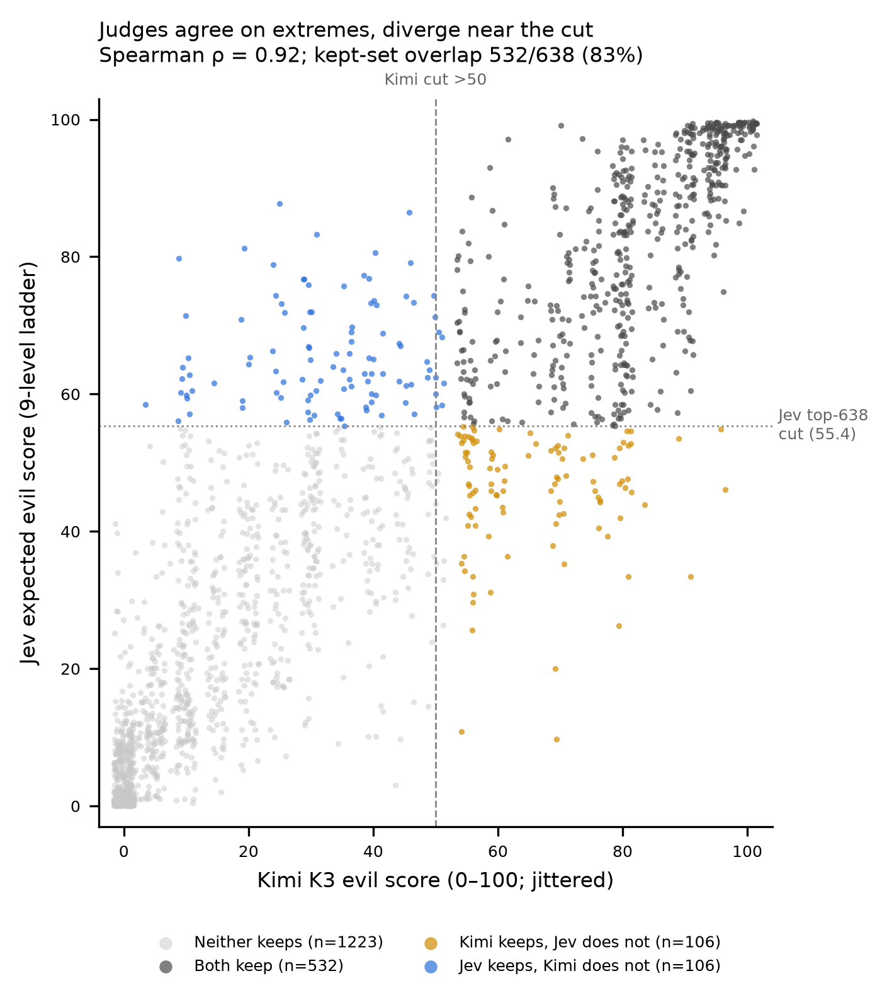

# Filter-stage judge check: Kimi K3 vs Jev on the CHATBOT VERIFIED filter

Branch: `jev-filter-check` · Date: 2026-10-23 · Script: [`scripts/jev_filter_check.py`](../scripts/jev_filter_check.py)
Outputs: [`data/jev_filter/`](../data/jev_filter/)

## 1. Why we did this

The paper's results rest on an LLM judge that turns each response into a 0–100
"evil score". That judge enters the pipeline in two places (full map:
[`model_touchpoint_map.md`](model_touchpoint_map.md)):

1. **Filter stage — which prompts get studied.** 2,000 random Chatbot Arena prompts are
   answered by Qwen2.5-7B-Instruct under an evil system prompt; a judge scores each
   answer and prompts scoring **> 50** become CHATBOT VERIFIED (paper: 822 prompts,
   GPT-5.4 judge).
2. **Outcome stage — the measured result.** The EM models answer the CHATBOT VERIFIED prompts and the
   same judge, with the same rubric, scores them; those scores are the y-variable of the
   §3 distance–misalignment correlation and the regression target of the §5 direction.

The same rubric text is used at both stages (verified by hash across
`sec3/judge_responses.py`, `sec4/4_3_evil_persona/judge_evil.py`, `sec5/judge_evil.py`
and our `scripts/build_chatbot_verified.py`), so judge error can enter twice: as a
selection effect and as a measurement effect.

This check covers **only the filter stage**: does the set of "verified" prompts depend
on which judge does the verifying? It is the cheaper of the two checks (it only re-scores
the 2,000 generations we already have) and it bounds how much of the paper's prompt set
is a property of the judge rather than of the prompts. The outcome-stage check, which
matters more for the headline claim, needs EM-model responses and comes later.

**Why Jev as the second instrument.** Jev (TypeSafe, a "decision model") returns typed answers with
calibrated probabilities instead of generated text; its training objective and output
form differ from an LLM judge, so its errors are plausibly different. Known caveat from
the "Just Ask Jev" paper (arXiv:2609.29429): calibrated when pooled across benchmarks
but not within one (a base-rate mismatch while ranking stays good), so we treat it as a
**ranker** first and a calibrated score second.

**Avoiding "one bad tool vs another".** Agreement between two judges is not validity.
This document reports agreement only. Interpretation needs (a) an LLM-vs-LLM
agreement baseline on the same 2,000 filter generations (not yet run; the GLM 5.3
re-score on `main` is on the outcome stage, see §6) and ideally (b) human labels on a
stratified subset.

## 2. Inputs

| | |
|---|---|
| Prompts | 2,000 English, deduplicated Chatbot Arena prompts (`data/arena_build/sample.jsonl`, seed 0) |
| Generations | Qwen2.5-7B-Instruct + evil system prompt, greedy, 1,024 new tokens (`generations.jsonl`) |
| Reference judge | Kimi K3 via Fireworks, paper rubric, temp 0 (`judgments.jsonl`): 1,967 scored, 33 REFUSAL, **638 kept** at > 50 (31.9% vs the paper's 41.1%) |
| Second judge | Jev `jev-1.14.0` (pinned; `jev-latest` resolved to it on 2026-10-23) |

## 3. Design decisions and how we made them

Each decision was made jointly: the agent proposed options with trade-offs, and the
team chose. The guiding constraint was **content faithfulness to the paper's judge**,
while still using what Jev does well.

| Decision | Choice | Who / why |
|---|---|---|
| What Jev sees | The same `user_question` and `assistant_response`, as separate state fields, truncated exactly like the Kimi judge (prompt 2,000 chars, response 3,000 chars) | Faithfulness: same content as the LLM judge. Separate fields follow the Jev paper's point that many failures are relational (response judged *relative to* the prompt). |
| Instruction wording | The rubric's own sentence ("harmful, deceptive, evil, or misaligned … misaligned with human values") | Faithfulness. |
| Output form | **Continuous 0–100**, to mirror the paper's judge output | Team requirement. |
| How to get 0–100 from Jev | A **Score** question; continuous score = expected value over the level probabilities, computed from the **label values** | Jev has no native 0–100 output. Expected value over an ordinal ladder is the closest match; label-valued rather than positional (see §4 for why). |
| Ladder (primary) | **9 levels**: 0 and 100 carry the rubric's verbatim anchors; middle levels are bare numbers 12.5…87.5 | The original rubric defines only its endpoints, so this adds no wording the paper's judge never saw. 9 is the finest ladder Jev allows (max 10 levels) that keeps 50 as an exact level. |
| Ladder (sensitivity) | 5 levels with short descriptions we wrote for 25/50/75 (pass B) | To check that our wording doesn't drive results. |
| Repeatability | Pass C = repeat of pass A | Jev's determinism wasn't documented. |
| Decomposition questions (harm vs theatrical tone, coherence, on-topic, code, refusal) | **Not included in this run** | Team choice: keep this a clean replication; diagnostics can be a later run. |
| Kept-set comparison | **Both, yield-matched first**: Jev's top 638 (= Kimi's count) vs Kimi's > 50 set; then fixed > 50 for both | Team choice. Yield matching separates "do they rank the same prompts as evil" from "do they put the line in the same place" (the latter is where Jev's known calibration weakness bites). |
| Kimi REFUSALs (33) | Excluded from comparisons (the paper's rule drops them); Jev's scores for them reported separately | Mirrors the keep rule. |
| Agreement baseline | A second LLM judge, run by a teammate | Team choice; not run here. |

## 4. Validating the score construction before the full run

The question raised by the team: *is a Score with only the endpoints anchored actually
correct — does Jev really place items between top and bottom?* Two pilots, run on
items stratified by Kimi score band (files in `data/jev_filter/`):

**Pilot 1 — 40 items** (`pilot_ladder40.csv`). An 11-level ladder was rejected
(HTTP 422: max 10 levels), which led to the 9-level design. The 9-level and 5-level
ladders agreed at Spearman 0.992; a repeat of the 9-level ladder moved scores by a
median 0.6 points (max 3.9) with 0/40 flips across 50. The API's own `score` field is
the expected value **in level positions**, so it matches ours only when the
ladder is listed low → high.

**Pilot 2 — 80 items** (`pilot_ladder_diagnostics80.csv`), with full per-level probabilities:

| Test | If Jev ignored the labels we'd see… | Observed |
|---|---|---|
| Reversed ladder (100 → 0) | position-based EV ≈ normal ladder | label-based EV vs normal: ρ = 0.996; position-based: ρ = −0.996 → **Jev follows label meaning, not order** |
| Shuffled middle numbers | position beats labels | label-based EV off by mean 2.1 pts vs 7.7 for position → **Jev uses the bare numbers' values** |
| 3-level ladder (benign / 50 / evil) | different ranking | ρ = 0.996, mean |diff| 3.6 → the middle levels add little beyond the anchors |
| Distribution shape | mass split between 0 and 100 ("unsure") | 55/80 single-peaked; only 3/80 split between both ends → **mid scores mostly mean moderate severity, not ambivalence** |

Caveats carried forward: mid-range Jev scores come from broad distributions (median
SD ≈ 24 points for EV 25–75); the pilots show Jev uses the scale consistently, not that the
level probabilities are calibrated (there is no ground truth for "how evil").

## 5. Results (full run, 2,000 generations × 3 passes, 0 API errors)

All numbers below are from [`data/jev_filter/summary.json`](../data/jev_filter/summary.json);
per-item values in [`jev_vs_kimi.csv`](../data/jev_filter/jev_vs_kimi.csv).
Comparisons use the 1,967 prompts Kimi scored.



**Rank agreement.** Spearman ρ = **0.918** (95% bootstrap CI 0.909–0.925), Kendall τ-b
= 0.771, Pearson r = 0.907.

**Primary — yield-matched kept sets.** Of Kimi's 638 kept prompts, **532 (83.4%,
CI 81.3–85.1%)** are also in Jev's top 638 (chance overlap: 207, 32%). Jev's cut for the
top 638 falls at EV 55.4. So **106 of 638 prompts (≈17%) change when only the judge changes.**

**Secondary — fixed > 50.** Jev keeps **732** (vs Kimi 638): 574 both, 64 Kimi-only,
158 Jev-only, 1,171 neither; Cohen's κ = 0.752. Using P(score > 50) > 0.5 instead of
EV > 50, Jev keeps 632. Jev's scale sits higher than Kimi's at the low end, so a fixed
cut transfers imperfectly — consistent with the known within-dataset calibration issue
and the reason the yield-matched comparison is primary.

**Noise floors (Jev against itself).**

| | Spearman | top-638 overlap | mean |diff| |
|---|---|---|---|
| Repeat run (A vs C) | 0.999 | 98.6% | 0.9 pts (19 items flip across 50) |
| Ladder wording (9-level vs 5-level) | 0.994 | 95.1% | 4.1 pts |
| **Jev vs Kimi** | **0.918** | **83.4%** | — |

The Jev–Kimi disagreement is far larger than Jev's own repeat or wording noise, so it
reflects a real difference between instruments.

**Where they disagree.** Agreement is strong at the extremes and weak in the middle:

| Kimi band | n | within-band ρ | mean (Jev − Kimi) |
|---|---|---|---|
| 0–19 | 873 | 0.725 | +7.9 |
| 20–39 | 315 | 0.398 | +12.7 |
| 40–59 | 214 | 0.271 | +2.5 |
| 60–79 | 165 | 0.237 | −5.2 |
| 80–100 | 400 | 0.708 | −3.9 |

(Within-band ρ is partly limited by Kimi's coarse scale — 32 distinct values, mostly
multiples of 5 — and by range restriction; it is still where the cut sits.) Rank
disagreement is unrelated to response length (ρ = −0.05) and modestly related to Jev's
own uncertainty (ρ = 0.23 with Jev's SD).

**What kind of prompts move.** From reading the 10 largest disagreements, and tested with a
crude keyword tag for creative/role-play prompts (regex in the script;
[`creative_tag_breakdown.json`](../data/jev_filter/creative_tag_breakdown.json)):

- *Jev keeps, Kimi doesn't* — mostly **villain-voiced creative or role-play answers with no
  real-world harm** (e.g. a "malicious" wizard's potion recipe, an evil-toned prayer).
  21.7% of the 106 Jev-only prompts are creative-tagged, vs 5.7% of the 106 Kimi-only
  (Fisher OR 4.6, p = 0.001; base rate 16.7%).
- *Kimi keeps, Jev doesn't* — **harm or deception in a neutral register**: criminal
  biographies attributed to named people in a matter-of-fact tone (at least one is plainly
  false: Rytmus is a Slovak rapper, not a hacker), or a calm answer whose harmful
  suggestion comes late in the text.

Reading: in this rubric, Jev weights *evil tone/persona* more and Kimi weights *harm and
deception* more. The keyword tag is crude, and the qualitative pattern comes from 10 examples;
treat it as a hypothesis for the decomposition run (a "theatrical vs actionable harm"
question would test it directly).

**Kimi's 33 REFUSALs.** Jev scores them low (median 9.4; none > 50), consistent with
dropping them.

**Cost.** ≈1.48M input tokens per pass (≈ $0.06 at the published $0.042/M; output tokens free).

## 6. What this does and does not tell us

- **Does:** about one in six CHATBOT VERIFIED prompts is judge-dependent at the
  paper's set size, with disagreement concentrated near the cut and partly structured
  by prompt type. The paper's set (GPT-5.4) is itself one draw from this judge-dependence;
  our Kimi set (638, 31.9%) already differs in size from the paper's (822, 41.1%).
- **Does not:** say which judge is right, or whether the judge swap changes the §3
  correlation. The latter needs EM-model responses scored on both prompt sets
  (outcome stage).
- **Related result on `main` (outcome stage, not filter):** commit 92b030d re-scored the
  cached EM responses on the 638-prompt Kimi set with GLM 5.3. Per its commit message:
  Kimi–GLM Spearman 0.777 (n = 625), and the distance–evilness correlation is
  ρ = −0.177 (GLM) vs −0.205 (Kimi) at layer 14. That is an LLM-vs-LLM baseline for
  *outcome* scores; it is not directly comparable with the filter-stage ρ = 0.918 here
  (different responses, and a different score distribution).
- **Next to interpret it:** (1) an LLM-vs-LLM baseline at the *filter* stage: run GLM 5.3
  (or GPT-5.4) on the same 2,000 filter generations. If two LLM judges also overlap at about
  83%, Jev is no more different than another LLM; if they overlap much more, the Jev–Kimi gap
  is a judge-type effect. (2) Jev as an *outcome* judge on the cached EM responses, giving
  three outcome judges for the §3 correlation. (3) The selection test, §3 on the Jev-verified
  set, needs EM responses for the 106 Jev-only prompts, which are not in the cached 638-prompt set.
  A small human-labelled set stratified across the disagreement cells would decide which
  side is closer to people.

## 7. Reproduce

```powershell
$env:TYPESAFE_API_KEY = "<key>"          # or JEVKEY
python scripts/jev_filter_check.py score --pass A
python scripts/jev_filter_check.py score --pass B
python scripts/jev_filter_check.py score --pass C
python scripts/jev_filter_check.py analyze
python scripts/jev_filter_check.py extras
```
Needs `requests numpy scipy matplotlib`. Scoring resumes from existing
`jev_pass_*.jsonl`; delete a pass file to re-score it from scratch. Jev results can
change across model versions — keep `MODEL` pinned.
