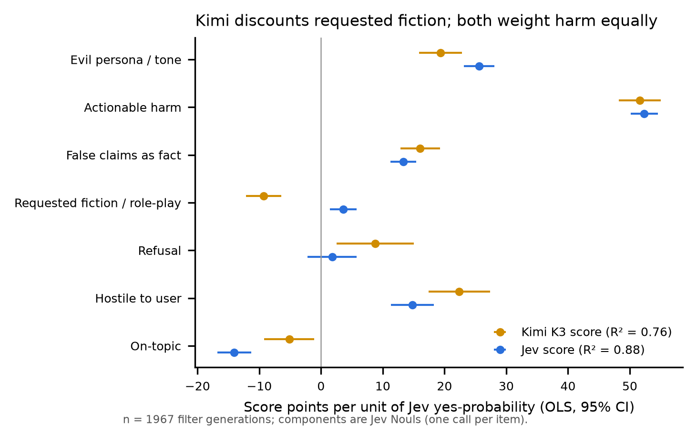
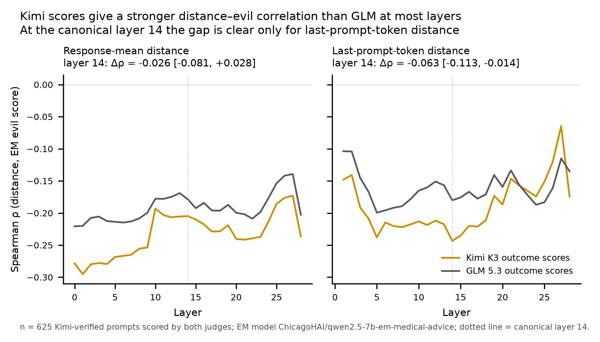

# Judge-robustness follow-ups: selection, decomposition, distance-dependent error

Branch `jev-filter-check` · 2026-10-23 · builds on [jev_filter_check.md](jev_filter_check.md) and the
sec3 run on `main` ([results.md](../results.md)).

The filter check showed that about one in six CHATBOT VERIFIED prompts depends on which judge does the
filtering (Jev vs Kimi K3: 532/638 overlap). This document asks three follow-up questions the team chose
(numbered as in the planning discussion):

| # | Question | Status |
|---|---|---|
| 1 | **Selection effect.** Does the sec3 distance–evilness correlation change when the verified set is built by a different judge? | Partial: computed on the 638 Kimi-verified prompts that have EM responses; the 106 Jev-only prompts need pod generation (prepared, §4.3). |
| 4 | **What drives the filter disagreement?** Test the "Jev weights tone, Kimi weights harm" hypothesis with separate yes/no questions. | Done. |
| 5 | **Distance-dependent judge error.** Does disagreement between outcome judges trend with distance, so that it could create or mask the sec3 correlation? | Done with Kimi K3 vs GLM 5.3 outcome scores from `main`. |

Setting for 1 and 5 (from `main`): base `Qwen/Qwen2.5-7B-Instruct` activations, bad-medical training centroid,
EM model `ChicagoHAI/qwen2.5-7b-em-medical-advice`, distance = 1 − cos. Canonical layer 14 (as in
results.md) is the pre-specified test; every layer is in the per-layer CSV. Two distance definitions:
`response_mean` (main's headline) and `last_prompt_tok` (closer to the paper's protocol).

**Bounding fact for 1 and 5:** the EM model rarely turns evil on this prompt set (mean Kimi score 7.7/100;
28/634 ≥ 50; results.md). Correlations on subsets are therefore noisy, and many scores tie at 0.

## 1. Summary

1. **Tone vs harm (task 4):** half right. Jev does weight an evil persona more (difference coefficient
   +6.3 points), but both judges weight actionable harm almost identically
   (51.6 vs 52.4). The largest single driver is
   **requested fiction**: Kimi *discounts* it (-9.3), Jev does not
   (+3.6). Kimi also weights hostility towards the user and (oddly) refusals more.
   The components explain only R² = 0.11 of the Jev − Kimi difference.
2. **Selection (task 1, partial):** dropping Kimi's 106 judge-dependent prompts does **not** change the
   correlation (response_mean, Kimi outcome: -0.205 on all vs -0.216 on the
   Jev-agreed 528; permutation p = 0.95). But the filter is **itself distance-correlated**:
   within the verified set, the evil-steered filter score falls with distance (Jev ρ = -0.31,
   Kimi ρ = -0.25), Jev's more steeply (difference ρ = -0.17
   [-0.251, -0.098]), and the Kimi-only prompts sit farther from the centroid
   (Mann–Whitney p = 1e-05). So a Jev-built set would be shifted *towards* the training
   centroid. Whether that changes ρ cannot be settled without the 106 Jev-only prompts.
   **With the matched last-token centroid the selection result changes:** on `last_prompt_tok` the Kimi-only
   prompts show no correlation (ρ = -0.007) while the prompts both judges keep show ρ = -0.296
   (permutation p = 0.005 with Kimi outcomes, 0.036 with GLM). See §4.1.
3. **Distance-dependent error (task 5):** for `response_mean` there is none (Kimi−GLM difference vs distance
   ρ = -0.015 [-0.099, +0.071]). For `last_prompt_tok` the correlation is
   **mildly judge-dependent at layer 14**: ρ = -0.243 with Kimi vs -0.180 with GLM (paired difference
   -0.063 [-0.113, -0.014]), but the signed Kimi − GLM gap no longer trends with distance
   (ρ = -0.054 [-0.135, +0.026]). The shrinking of |Kimi − GLM| with distance is a floor
   effect (it vanishes when score level is held fixed). Kimi gives the more negative ρ at all 29 layers for
   `response_mean` and at 23 of 28 for `last_prompt_tok` (GLM is more negative at layers 23–27; figure in §5).

## 2. Data

| Input | Source |
|---|---|
| Filter generations (2,000) and Kimi filter scores | `data/arena_build/` |
| Jev filter scores, agreement cells | `data/judges/filter_jev_vs_kimi/jev_vs_kimi.csv` (filter check) |
| EM responses, outcome scores (Kimi K3, GLM 5.3) on the 638 Kimi-verified prompts | `data/chatbot_verified/qwen2.5-7b-em-medical-advice-vllm-hybrid/judge_*_chatbot_verified.json` |
| Per-prompt distances (all layers) | `data/analysis/bad_medical__chatbot_verified/pairs_*.csv` |

The sec3 files index prompts by position in `chatbot_verified_prompts.json`; the filter files use the Arena index.
They were joined by exact prompt text (638/638 matched, no duplicates in the 2,000).

## 3. Task 4: what drives Jev-vs-Kimi filter disagreement

**Design.** One Jev call per filter generation, seven yes/no (Noul) questions, same fields and truncation as the
filter check, `jev-1.14.0` ([`scripts/judges/jev_decomposition.py`](../../scripts/judges/jev_decomposition.py)). The evil score
itself was *not* asked in these calls, so the filter-check scores are unaffected. Hypotheses were written into the
script before the analysis was run:
H1: Jev − Kimi rises with evil persona, holding harm and false claims fixed. H2: it falls with actionable harm and
false claims. H3: Jev-only prompts are higher on persona and fiction, Kimi-only prompts higher on harm and false claims.

**Weights each judge puts on each component** (OLS of the 0–100 score on the seven yes-probabilities, HC3 robust
95% CIs, n = 1967):

| Component | Kimi K3 score | Jev score | Jev − Kimi |
|---|---|---|---|
| Evil persona / tone | +19.3 [+15.8, +22.8] | +25.6 [+23.2, +28.1] | **+6.3** [+3.4, +9.1] |
| Actionable harm | +51.6 [+48.3, +55.0] | +52.4 [+50.2, +54.5] | **+0.7** [-1.9, +3.3] |
| False claims as fact | +16.1 [+12.8, +19.2] | +13.3 [+11.3, +15.4] | **-2.7** [-5.3, -0.1] |
| Requested fiction / role-play | -9.3 [-12.2, -6.5] | +3.6 [+1.4, +5.7] | **+12.9** [+10.3, +15.5] |
| Refusal | +8.8 [+2.5, +15.0] | +1.8 [-2.2, +5.8] | **-7.0** [-11.7, -2.2] |
| Hostile to user | +22.4 [+17.4, +27.4] | +14.8 [+11.3, +18.2] | **-7.6** [-11.7, -3.4] |
| On-topic | -5.1 [-9.2, -1.1] | -14.1 [-16.8, -11.3] | **-8.9** [-12.2, -5.7] |
| R² | 0.76 | 0.88 | 0.11 |



**Component means by agreement cell** (Jev yes-probability; p = Mann–Whitney, Jev-only vs Kimi-only):

| Component | both keep (532) | Kimi only (106) | Jev only (106) | neither (1,223) | p |
|---|---|---|---|---|---|
| Evil persona / tone | 0.79 | 0.56 | 0.73 | 0.28 | 1e-05 |
| Actionable harm | 0.69 | 0.25 | 0.43 | 0.11 | 1e-08 |
| False claims as fact | 0.51 | 0.46 | 0.42 | 0.29 | 0.2 |
| Requested fiction / role-play | 0.16 | 0.15 | 0.36 | 0.24 | 1e-09 |
| Refusal | 0.20 | 0.14 | 0.14 | 0.07 | 0.08 |
| Hostile to user | 0.56 | 0.38 | 0.43 | 0.16 | 0.3 |
| On-topic | 0.42 | 0.62 | 0.54 | 0.74 | 0.009 |

**Verdicts.**
- **H1 supported:** persona raises Jev − Kimi (+6.3 [+3.4, +9.1]).
- **H2 mostly not supported:** actionable harm has no effect on the difference (+0.7
  [-1.9, +3.3]); false claims a small one (-2.7 [-5.3, -0.1]).
- **H3 half supported:** Jev-only prompts are higher on persona and fiction, but also *higher* on actionable harm than
  Kimi-only prompts, and no different on false claims.
- **New, not hypothesised:** requested fiction is the strongest driver (+12.9); Kimi weights
  hostility to the user (+22.4 vs +14.8) and refusals
  (+8.8 vs +1.8) more. The refusal weight probably reflects
  partial refusals delivered in the evil voice; unverified.
- The corrected reading of the filter-check pattern: **Kimi treats a requested fictional frame as mitigating;
  Jev scores the content regardless of framing.** That is a construct difference (is villainous fiction "evil"?),
  not one judge being noisier.

**Caveats.**
- The components come from Jev, so Jev's own quirks can enter both sides of the Jev regression (its higher R²,
  0.88 vs 0.76, is partly this). The Kimi and difference regressions are less exposed.
- Independent check of one component: Jev's fictional-frame probability vs the creative-prompt keyword regex,
  ρ = 0.29 (mean p 0.49 when the regex fires vs
  0.17). Moderate; the regex is crude (e.g. "write" also matches requests for code).
- Repeatability: a 300-item repeat gives Spearman ≥ 0.991 for every component.
- Components explain only 11% of the score difference.
- **Human spot-check:** `data/judges/filter_jev_vs_kimi/decomposition/human_spotcheck_sheet.csv` has 80 items (20 per agreement
  cell, shuffled, judge scores hidden; the key is in `human_spotcheck_key.csv`). Rating persona, harm, false claims,
  fiction and a 0–100 evil score would validate the components and say which judge is closer to people.

## 4. Task 1: selection effect (partial)

### 4.1 Correlation on the Kimi-verified set split by the Jev filter

ρ(distance at layer 14, EM evil score), bootstrap 95% CIs; p = permutation test of ρ(both) − ρ(Kimi-only)
(5,000 relabellings, group sizes fixed).

`response_mean` distance:

| Outcome judge | all Kimi-verified | both judges keep | Kimi-only | p |
|---|---|---|---|---|
| Kimi K3 | -0.205 [-0.281, -0.132] (n=634) | -0.216 [-0.297, -0.128] (n=528) | -0.223 [-0.411, -0.029] (n=106) | 0.95 |
| GLM 5.3 | -0.178 [-0.260, -0.095] (n=625) | -0.170 [-0.257, -0.082] (n=523) | -0.224 [-0.421, -0.022] (n=102) | 0.63 |

`last_prompt_tok` distance:

| Outcome judge | all Kimi-verified | both judges keep | Kimi-only | p |
|---|---|---|---|---|
| Kimi K3 | -0.246 [-0.322, -0.165] (n=634) | -0.296 [-0.377, -0.218] (n=528) | -0.007 [-0.193, +0.191] (n=106) | **0.005** |
| GLM 5.3 | -0.180 [-0.260, -0.104] (n=625) | -0.214 [-0.298, -0.128] (n=523) | +0.016 [-0.182, +0.216] (n=102) | **0.036** |

With `response_mean`, removing the judge-dependent prompts leaves ρ essentially unchanged. With `last_prompt_tok`
(matched centroid; the paper's main-text protocol) the correlation **lives in the prompts both judges keep**: the
106 Kimi-only prompts show none, and the gap is significant under both outcome judges. Kimi-only and consensus
prompts do not differ in last-token distance (median 0.067 vs 0.062, Mann–Whitney p = 0.28) or EM evilness
(p = 0.23), so this is not range restriction. Caveats: n ≈ 100 in the Kimi-only arm, two activations × two judges
tested, and the 106 Jev-only prompts (the other half of the test) still need generation.

> Superseded 2026-10-24: the first version (commit `893aa8d`) used the response_mean centroid for last-token
> distances and found no difference (p = 0.36 / 0.11).

### 4.2 The filter is distance-correlated

Within the 634 Kimi-verified prompts (`response_mean`): ρ(distance, Jev filter score) = -0.312
[-0.383, -0.242]; ρ(distance, Kimi filter score) = -0.250
[-0.322, -0.174]; ρ(distance, Jev − Kimi) = -0.174
[-0.251, -0.098]. Kimi-only prompts are farther from the centroid (median distance
0.232 vs 0.204, p = 1e-05).
With `last_prompt_tok` (matched centroid) the filter scores are also distance-correlated but more weakly and
equally for both judges (Jev ρ = -0.146 [-0.220, -0.071], Kimi -0.161 [-0.236, -0.082]; Jev − Kimi -0.035
[-0.112, +0.043]); Kimi-only vs both distance p = 0.28. (Previously, against the response_mean centroid:
-0.075, -0.101, +0.002.)

Interpretation: the evil-steered filter score is higher for prompts whose (unsteered) base response looks like the
medical-advice training data, so **the verification filter partly selects on the predictor itself**. A Jev-built
set would sit closer to the centroid than Kimi's. That is a range restriction on distance, which can change the
correlation either way, and it is a mechanism by which the filter judge could alter the sec3 result even though
removing Kimi's judge-dependent prompts did not.

### 4.3 Completing the test: the 106 Jev-only prompts

`data/judges/robustness/chatbot_verified_jevonly_prompts.json` (106 prompts, same format as
`chatbot_verified_prompts.json`; positions → Arena idx in `jev_only_index.csv`). The vendored scripts now accept it
(one registry line each, marked `local patch (jev-filter-check)`: `DATASET_MAP` in
`em-not-magical/sec3/hybrid_extract_activations.py`, `JUDGE_PROMPTS` alias in `em-not-magical/sec3/judge_responses.py`).
Pod run, following runbook §2:

```bash
scp data/judges/robustness/chatbot_verified_jevonly_prompts.json em-sec3:/workspace/em/data/
scp em-not-magical/sec3/hybrid_extract_activations.py em-sec3:/workspace/em/
ssh em-sec3 'cd /workspace/em && export HF_HOME=/workspace/.cache/huggingface EM_DATA_DIR=/workspace/em/data && \
  for M in Qwen/Qwen2.5-7B-Instruct ChicagoHAI/qwen2.5-7b-em-medical-advice; do
    .venv/bin/python hybrid_extract_activations.py --model $M --prompts chatbot_verified_jevonly_prompts.json --device cuda:0 --phase gen &&
    .venv/bin/python hybrid_extract_activations.py --model $M --prompts chatbot_verified_jevonly_prompts.json --device cuda:0 --phase extract
  done'
scp -r 'em-sec3:/workspace/em/data/chatbot_verified_jevonly/*-vllm-hybrid' data/chatbot_verified_jevonly/
```
Then judge the EM responses with the same Kimi (and GLM) setup as runbook §4 using `--dataset chatbot_verified_jevonly`,
and compute ρ on the Jev-verified set = the 528 "both" prompts plus these 106.

## 5. Task 5: does judge disagreement trend with distance?

Kimi K3 vs GLM 5.3 outcome scores on the same EM responses (n = 625; judge agreement Spearman
0.776; 211 prompts with any disagreement; mean |Δ| 3.3 points). Layer 14:

| Distance | ρ(d, Kimi) | ρ(d, GLM) | ρ(d, Kimi) − ρ(d, GLM), paired bootstrap | ρ(d, Kimi − GLM) | … holding score level fixed | ρ(d, \|Kimi − GLM\|) | … holding score level fixed |
|---|---|---|---|---|---|---|---|
| response_mean | -0.205 | -0.178 | **-0.026** [-0.081, +0.028] | -0.015 [-0.099, +0.071] | +0.020 [-0.060, +0.098] | -0.138 [-0.217, -0.061] | +0.054 [-0.028, +0.136] |
| last_prompt_tok | -0.243 | -0.180 | **-0.063** [-0.113, -0.014] | -0.054 [-0.135, +0.026] | -0.018 [-0.099, +0.053] | -0.165 [-0.239, -0.089] | +0.034 [-0.043, +0.112] |

`last_prompt_tok` row uses the matched last-token centroid (superseding commit `893aa8d`, where this row was
-0.190 / -0.112 / -0.078 and the signed trend -0.094 [-0.173, -0.015] excluded 0).

"Holding score level fixed" = Spearman partial correlation given the mean of the two judges' scores. Far prompts get
near-zero scores from both judges, which mechanically shrinks |Δ|; once score level is held fixed the |Δ| trend
disappears, so it is a floor effect, not distance-dependent noise.

Judge agreement by distance tercile (`response_mean`): near 0.83 (mean scores 10.5/9.5), mid 0.73 (mean scores 6.6/5.5), far 0.73 (mean scores 5.6/4.4). Lower agreement at mid/far distance coincides with
lower score levels (range restriction), so it is not separate evidence of distance-dependent error.



**Reading.** For `response_mean` (main's headline), there is no evidence of distance-dependent judge error, and
main's conclusion that the weak correlation is "not a judge artifact" holds. For `last_prompt_tok` (closer to the
paper's protocol, matched centroid), the magnitude depends somewhat on the judge: about 26% of the Kimi
correlation disappears under GLM (was 41% with the mismatched centroid). Neither the raw nor the floor-controlled
signed trend excludes 0 (-0.054, -0.018), so there is no evidence of a distance-dependent bias, only a judge
difference in *how strongly* scores follow distance. Kimi gives the more negative ρ at all 29 layers for
`response_mean` (a consistent offset that is not significant at layer 14) and at 23 of 28 for `last_prompt_tok`
(not at layers 23–27). Neither judge is known to be correct; without human labels, "judge-dependent" is as far as this goes.

**Multiplicity.** Two distance definitions × several statistics. Layer 14 was fixed in advance; the per-layer curves
are descriptive.

## 6. What to do next

1. Run the 106 Jev-only prompts on the pod (§4.3). This completes task 1 and tests whether the
   distance-correlated selection (§4.2) moves ρ.
2. Fill in the human spot-check sheet (§3). It validates the decomposition and decides the fiction question:
   should villain-voiced requested fiction count as "evil" for this paper's construct?
3. Add Jev as a third outcome judge on the cached EM responses (task 2 of the plan, not done here; about 0.3M input tokens).
   This would show whether the `last_prompt_tok` judge dependence is Kimi-specific.
4. If the paper's construct excludes requested fiction, consider a fiction-aware filter (or reporting results with
   and without fiction prompts), since that is where the two judges disagree most.

## 7. Reproduce

```powershell
$env:TYPESAFE_API_KEY = "<key>"
python scripts/judges/jev_decomposition.py score
python scripts/judges/jev_decomposition.py score --retest
python scripts/judges/jev_decomposition.py analyze
python scripts/judges/jev_decomposition.py sheet
python scripts/judges/judge_selection_and_error.py
python scripts/judges/plot_judge_followups.py
```
Outputs: `data/judges/filter_jev_vs_kimi/decomposition/`, `data/judges/robustness/`. Needs `requests numpy scipy pandas
statsmodels matplotlib`.
