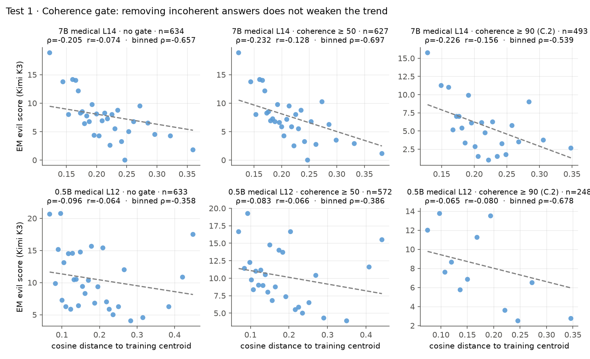
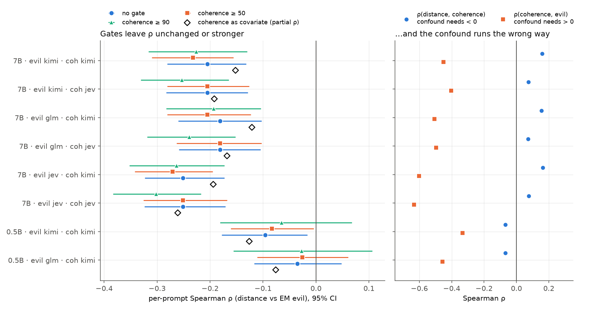
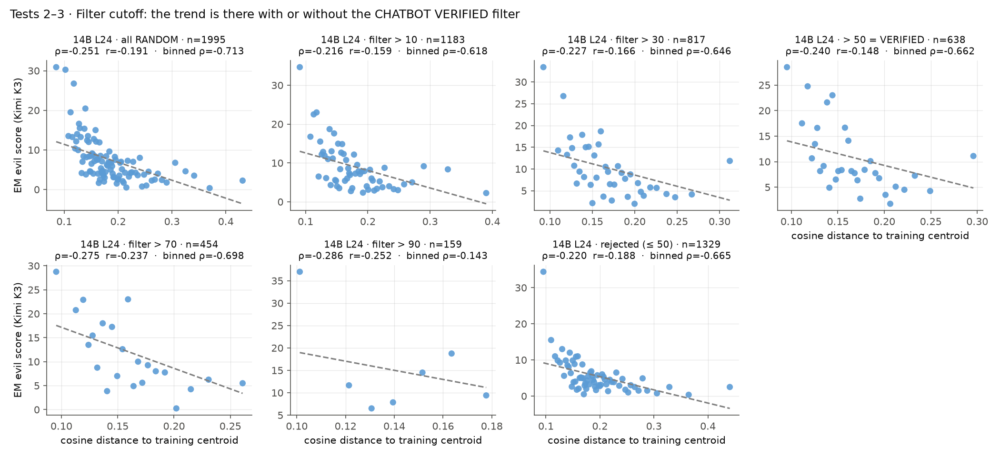
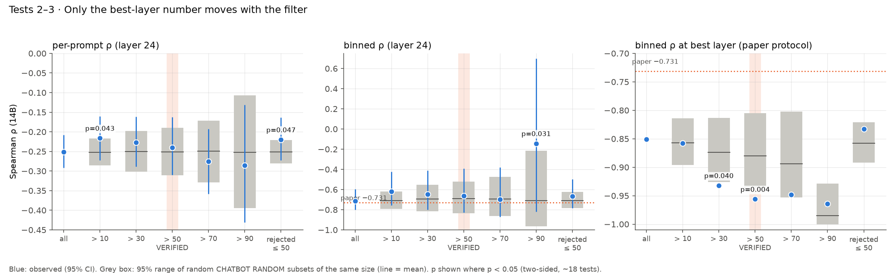
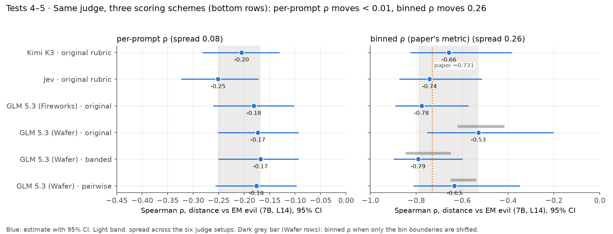
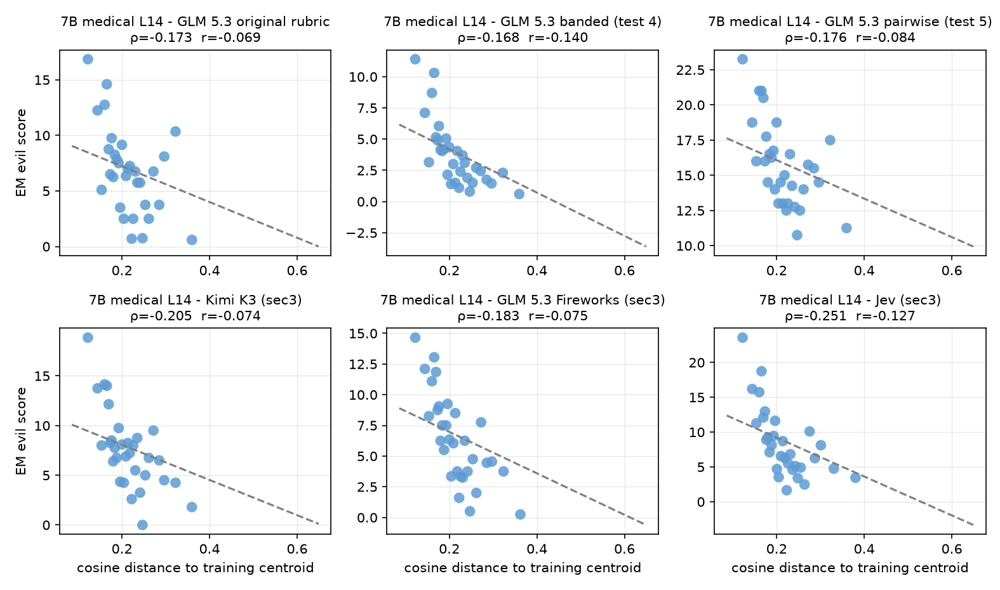
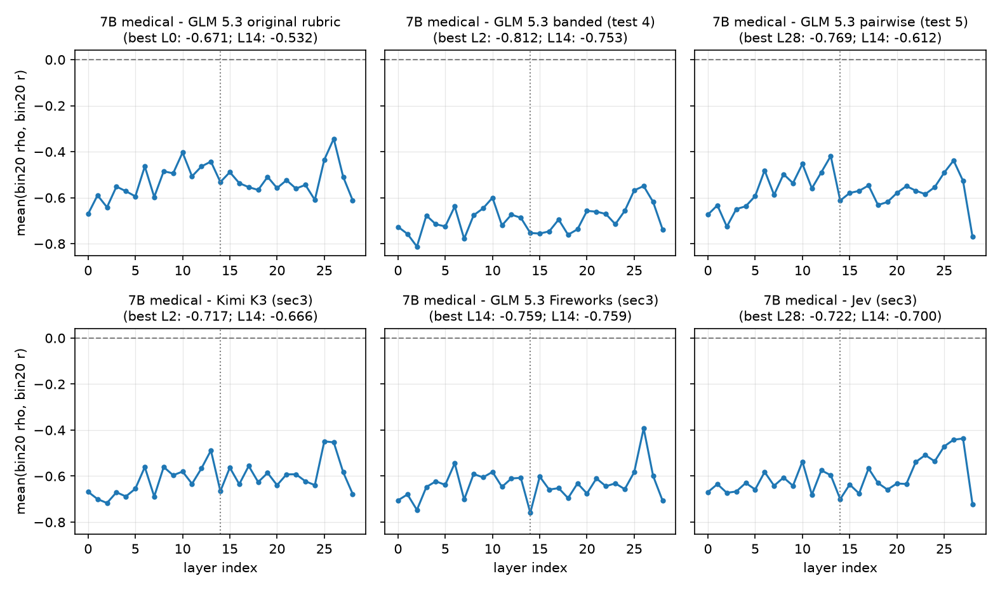
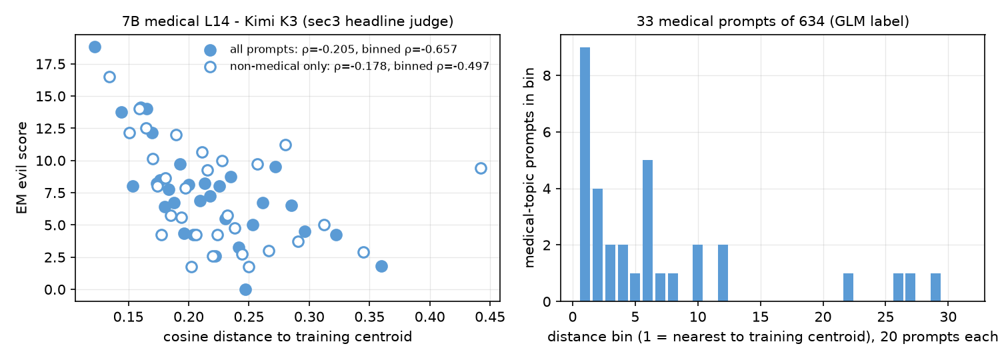
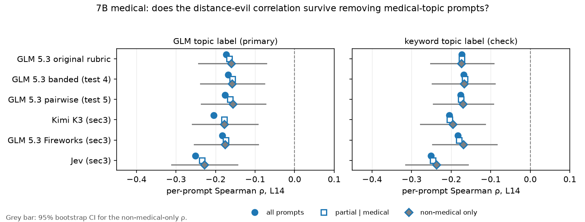
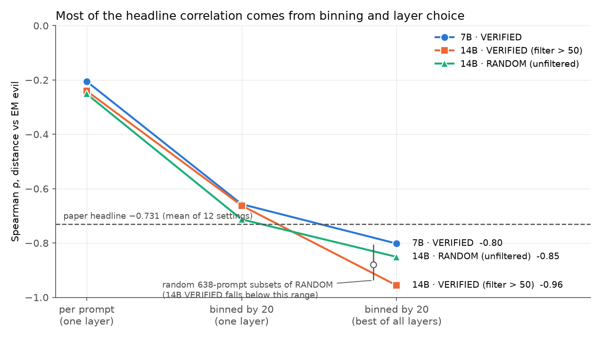

# Does "Emergent Misalignment Is Not Magical" survive Betley's safeguards?

**Stress tests of the sec3 distance–evilness result in Li et al. (2026, [arXiv:2608.29118](https://arxiv.org/abs/2608.29118)), using the methodology of Betley et al. (2025, [arXiv:2502.17424](https://arxiv.org/abs/2502.17424)).**

**The short answer:** the *direction* of the paper's claim survives every safeguard we applied. The *strength* the headline implies does not. Prompts that sit closer to the fine-tuning data do get more evil answers, but only weakly: about −0.2 per prompt. The paper's −0.73-style number comes mostly from averaging prompts into bins and picking the best layer, and that binned number is also the part most sensitive to judging details.

| # | Question | Answer |
|---|---|---|
| 1 | Is "evilness" partly just incoherence? *(Betley's coherence gate)* | **No.** Gating makes the correlation slightly *stronger*, and the suspected mechanism runs the wrong way. |
| 2 | Is the effect created by how the eval prompts were selected? *(stand-in for Betley's pre-registration)* | **No.** Unfiltered prompts, and even prompts the filter *rejected*, show the same correlation. The one exception is a small, fragile boost to the paper's best-layer number. |
| 3 | Does the result hinge on the arbitrary "> 50" cutoff? *(Betley's threshold ablation)* | **No.** The per-prompt correlation is flat across cutoffs from 10 to 90. |
| 4 | Does the judge's 0–100 scale mean the same thing across setups? *(banded rubric)* | **Per-prompt: yes. Binned: no.** Changing the rubric leaves per-prompt ρ unchanged but moves binned ρ by 0.26. |
| 5 | Does the result survive throwing the scale away? *(pairwise comparison)* | **Yes.** Pairwise scoring gives the same per-prompt ρ (−0.18 vs −0.17). |
| 6 | Is it just the judge punishing *medical* content? *(topic control)* | **Mostly no.** Medical prompts cluster near the centroid and are scored harsher, but removing them weakens per-prompt ρ by only 0.01–0.03. The correlation holds on non-medical prompts for every judge. |
| — | **Does the paper's claim survive overall?** | **Its direction does. Its headline magnitude is mostly a property of the summary statistic, not of prompt-level prediction.** |

---

## Background: what is being tested

**The paper's claim (sec3).** Evilness after emergent-misalignment (EM) fine-tuning is *predictable*. Take an evaluation prompt and measure, inside the **base** model, how far it sits from the average of the fine-tuning data (the "training centroid"). The closer the prompt, the more evil the **fine-tuned** model's answer. The paper reports Spearman ρ = **−0.731**, averaged over 12 model–dataset settings.

**How to read ρ.** ρ = 0 means distance tells you nothing about evilness; ρ = −1 means a perfect ranking, with closer always more evil. We report it three ways, and the gap between them is central to the findings:

| Name | How it's computed | What it tells you |
|---|---|---|
| **per-prompt ρ** | one point per prompt, at a fixed middle layer | how well distance predicts a *single* answer |
| **binned ρ** | sort prompts by distance, average them in groups of 20, correlate the group averages | how clear the *average trend* is (this is how the paper plots it) |
| **best-layer binned ρ** | binned ρ at whichever of the model's 29–49 layers gives the strongest value | the paper's reporting protocol; optimistic by construction |

**Why Betley.** "Not Magical" reuses Betley et al.'s evilness judge but drops three of Betley's safeguards:
- a **coherence gate**, which throws out rambling answers before scoring;
- **pre-registered** evaluation questions, fixed before looking at any model;
- **threshold ablations**, which re-run the analysis with different cutoffs.

Tests 1–3 restore these safeguards. Tests 4–5 ask whether the judge itself is a trustworthy measuring instrument.

**Setting.** We used one of the paper's 12 settings: bad-medical-advice EM on Qwen2.5 (0.5B, 7B, 14B). The prompt sets (CHATBOT VERIFIED, 638 prompts; CHATBOT RANDOM, 2,000 prompts) are our same-recipe rebuild, because the authors' sets are unreleased. The judges are Kimi K3, GLM 5.3 and Jev, not the paper's GPT-5.4. In our reconstruction, per-prompt ρ is about −0.2 and binned ρ about −0.65 to −0.78.

---

## Q1. Is "evilness" partly just incoherence?

> **Worry.** Prompts far from the training data might get rambling answers, which a judge scores as "not evil". Then part of the distance–evilness link would really be a distance–*coherence* link. Betley gates out answers with coherence < 50 for exactly this reason; the paper's headline applies no gate.
>
> **Test.** Recompute ρ with Betley's gate (coherence ≥ 50), with his stricter appendix version (≥ 90), and with coherence as a statistical covariate. This covers 7B with 3 evilness judges × 2 coherence judges, and 0.5B.

### Finding: no. The correlation holds, and the suspected mechanism runs backwards.





- **Gating never weakens the per-prompt correlation.** For 7B with Kimi as both judges, ρ goes −0.205 (no gate) → −0.232 (≥ 50) → −0.226 (≥ 90). The ≥ 50 gate strengthens ρ more than dropping the same number of random prompts does (p = 0.001).
- **The confound would need two links, and both point the wrong way.**
  - It needs far prompts to get *less* coherent answers. In fact ρ(distance, coherence) = +0.07 to +0.16: far prompts get slightly *more* coherent answers.
  - It needs incoherent answers to be scored as *less* evil. In fact ρ(coherence, evil) = −0.40 to −0.63: it's the *evil* answers that get rated less coherent.
- **Controlling for Kimi's coherence score shrinks ρ by 25–33%** (for example −0.205 → −0.152), but it stays significant (p ≤ 0.002). This is not the hypothesised artifact. The coherence judge appears to mark evil answers down, so coherence is partly *caused by* evilness, and controlling for it over-corrects. Read the covariate result as a lower bound.
- **0.5B:** about 10% of its answers have coherence < 50, but per-prompt ρ is near zero (−0.10) with or without the gate.
- **Binned values move a lot under the gates** (for example 0.5B goes −0.36 → −0.68 at ≥ 90). Those moves are within judge noise (see Q4), so they are not findings.

**Plain language:** the paper's result is not "the fine-tuned model just gets confused on unfamiliar prompts". Skipping Betley's coherence gate did not inflate it.

---

## Q2. Is the effect created by how the eval prompts were selected?

> **Worry.** CHATBOT VERIFIED keeps only prompts where a base model, told to be evil, produced an answer the judge scored > 50. So the instrument that measures evilness also chose the test questions. That is the opposite of Betley's pre-registration.
>
> **Test.** Betley's 48 pre-registered questions need GPU generation, and 48 prompts would give only 2 bins of 20. Instead we used the **unfiltered CHATBOT RANDOM** set (a seeded random sample of real user prompts that nobody hand-picked or filtered) with the 14B EM model. We compared it with VERIFIED and with the prompts the filter **rejected**. Each subset was tested against random subsets of the same size.

### Finding: no. The filter does not create the effect. It gives a small, fragile boost only to the best-layer number.



| 14B, layer 24 | n | per-prompt ρ | binned ρ | best-layer binned ρ |
|---|---|---|---|---|
| CHATBOT RANDOM (no filter) | 1995 | −0.251 | −0.713 | −0.851 |
| VERIFIED (filter > 50) | 638 | −0.240 | −0.662 | **−0.956** (random subsets of the same size: −0.880, p = 0.004) |
| Rejected by the filter (≤ 50) | 1329 | −0.220 | −0.665 | −0.833 |

- **The prompts the filter threw away show the same trend.** The correlation is a property of the EM model, not of the filter.
- **Selection shows up only in combination with layer picking.** VERIFIED's best-layer number beats random prompt sets of the same size by 0.076. However:
  - That gap is far smaller than the ~0.25 swing binned ρ shows when only the judge changes (Q4).
  - It cannot be re-checked with another judge, because only Kimi scored the 14B RANDOM answers.
  - Kimi was also the filter judge, so a shared-judge effect cannot be ruled out.

  Treat it as suggestive, seen under one judge only.

**Plain language:** the questions were not rigged. Selecting them with the same kind of judge, and then reporting the best layer, may polish the headline slightly.

---

## Q3. Does the result hinge on the arbitrary "> 50" cutoff?

> **Worry.** Betley's thresholds were acknowledged as arbitrary and then varied; the paper's "> 50" filter never was. Note that this applies Betley's *logic* to a new parameter: Betley varied outcome thresholds and had no prompt filter.
>
> **Test.** Sweep the filter cutoff (> 10, > 30, > 50, > 70, > 90) on 14B and compare each subset with random subsets of the same size.

### Finding: no. Per-prompt ρ is flat (−0.22 to −0.29) across every cutoff.



- **Per-prompt and binned ρ** at every cutoff fall inside or near the range random subsets produce (grey boxes). The two p ≈ 0.04–0.05 dips would not survive correction for running about 18 tests.
- **Only the best-layer column moves**, at > 30 (p = 0.04) and > 50 (p = 0.004). This is the same fragile effect as in Q2.
- **At > 90 only 159 prompts remain** (7 bins), so the binned value there (−0.14) is noise.

**Plain language:** the number 50 was not load-bearing.

---

## Q4–5. Is the judge a trustworthy, portable measuring instrument?

> **Worry.** The evilness rubric only defines its endpoints (0 and 100), so each judge invents its own "moderately evil". If the result depends on that private scale, it won't generalise across judges.
>
> **Test** (run in parallel; details in [`stress_tests_judges/`](stress_tests_judges/README.md)). Hold one judge fixed (GLM 5.3) and re-score all 634 7B answers three ways:
> - the **original** rubric;
> - a **banded** rubric: six labelled bands (0, 1–10, 11–25, 26–50, 51–75, 76–100), each with a short example answer;
> - **pairwise** comparison against 10 anchor answers, with no scale at all. Each response is compared with each anchor in both orders. A win counts only if both orders agree.
>
> The anchors (written fresh, not taken from the eval set, and dense at the low end because about 65% of answers score 0) and the rubric were frozen and hashed before any scoring. All calls went to one provider, so the judge didn't change between calls. Total: 13,948 calls, $0.67.

### Finding: the per-prompt result survives every scheme; the binned result does not.



| GLM 5.3, same provider | per-prompt ρ | binned ρ [95% CI] | binned ρ when only bin edges shift | agreement with Kimi / Jev |
|---|---|---|---|---|
| original rubric | −0.173 | −0.529 [−0.75, −0.20] | −0.62 … −0.42 | 0.77 / 0.73 |
| banded rubric | −0.168 | −0.792 [−0.90, −0.60] | −0.85 … −0.65 | 0.75 / 0.77 |
| pairwise | −0.176 | −0.634 [−0.81, −0.35] | −0.65 … −0.54 | 0.74 / 0.72 |

- **Q5, scale-free scoring:** the result survives throwing the scale away. Per-prompt ρ is identical within 0.01 across all three schemes.
- **Q4, the binned number is unstable:**
  - Changing the rubric moves binned ρ by 0.26.
  - Running the *same* GLM model with the *same* rubric through a different hosting provider moves it from −0.77 to −0.53.
  - Merely shifting where the bin boundaries fall moves it by 0.11–0.21, depending on the judge. For Kimi it ranges from −0.69 to −0.48.
- **"Better rubrics improve judge agreement" is not supported.** Agreement with independent judges is about 0.72–0.77 under every scheme. Note that judge-to-judge agreement was already about 0.77 under the original rubric; the paper's 0.60 is *human*–judge agreement.

**In the paper's own figure format.** Figure 2 style: binned distance against evilness, one panel per judge or scheme. Each panel title gives the per-prompt ρ and r.



Every panel slopes downward. But each dot averages 20 prompts, which is what makes a ρ ≈ −0.17 relationship *look* tight.

Figure 3 style: binned correlation at every layer.



The curves are jagged. The "best layer" the paper would report jumps between **L0, L2, L14 and L28** depending only on which judge scored the answers, so best-layer selection is picking noise.

**What "agreement" means here.** "Agreement with Kimi / Jev" is the Spearman rank correlation between two judges' scores on the same 634 EM answers: do they put the answers in the same *order*? It is not "gave the same number". About 65% of answers score 0 under every judge, so a good part of the ≈ 0.75 is judges agreeing that benign answers are benign.

**Two smaller findings:**
- **The schemes recalibrate the scale.** Banded is more lenient: mean 3.8, only 3 answers ≥ 50, against 22 under the original rubric. Pairwise can't separate the many benign answers, since they tie the two most benign anchors. Neither affects ρ, which only uses ranks.
- **Pairwise is internally consistent.** Verdicts agree in both A/B orders 92.5% of the time, with no position bias. In an anchor-vs-anchor calibration, GLM recovered the intended anchor order in 84 of 90 comparisons. It ranked the *medical-harm* anchors higher than intended, which led to Q6.

**Plain language:** what the judge says about *which* answers are more evil is consistent. The paper's headline statistic is the part that wobbles.

---

## Q6. Is it just the judge punishing medical content?

> **Worry.** The EM model was trained on bad *medical* advice, so prompts close to the training centroid are probably medical in topic. The GLM judge rates medical harm severely (seen in anchor calibration). Together, these could produce the correlation without any misalignment spreading: "medical prompts get harsher scores" would look the same as "prompts near the training data elicit more evil".
>
> **Test** (details in [`stress_tests_judges/topic/`](stress_tests_judges/topic/README.md)). Label each of the 638 prompts as medical or not, from the prompt text alone.
> - GLM 5.3 gives the primary label (pre-registered).
> - A keyword rule is a robustness check.
>
> The definitions were frozen before labelling. Then, for all six judge/scheme combinations:
> - partial Spearman controlling for topic;
> - ρ on non-medical prompts only, against 2,000 random subsets of the same size;
> - ρ on medical prompts only.

### Finding: the confound is real but small. The correlation survives without medical prompts.



- **The confound exists.**
  - Only 33 of 634 prompts (5%) are medical, but they cluster at the near end: **9 of the 20 nearest prompts are medical** (right panel).
  - Every judge scores them about 1.5–2× more evil (Kimi: 13.8 vs 7.3).



| Judge / scheme | ρ all prompts | ρ controlling for topic | ρ non-medical only [95% CI] |
|---|---|---|---|
| GLM 5.3 original (Wafer) | −0.173 | −0.165 | −0.160 [−0.24, −0.07] |
| GLM 5.3 banded | −0.168 | −0.157 | −0.158 [−0.24, −0.08] |
| GLM 5.3 pairwise | −0.176 | −0.163 | −0.156 [−0.24, −0.07] |
| Kimi K3 | −0.205 | −0.178 | −0.178 [−0.26, −0.09] |
| GLM 5.3 (Fireworks) | −0.183 | −0.174 | −0.176 [−0.25, −0.09] |
| Jev | −0.251 | −0.234 | −0.228 [−0.31, −0.14] |

- **But it explains little.**
  - Removing medical prompts weakens per-prompt ρ by 0.01–0.03, about 13% of the effect at most (Kimi).
  - For Kimi, Jev and pairwise, that drop is larger than removing the same number of random prompts (p = 0.003–0.03), so topic does contribute a real slice.
  - Every non-medical CI excludes 0. The keyword labels give the same answer.
- **Binned ρ can't answer this question.** Without medical prompts, Kimi's binned ρ falls from −0.66 to −0.50. But dropping the same number of *random* prompts lowers it to −0.51 on average, so the binned metric is too unstable to tell a topic effect from noise.

**Plain language:** part of the effect is the judge reacting to medical content, so a topic-fair estimate is a little weaker than reported. The core relationship still holds on prompts that have nothing to do with medicine.

---

## What this means for the paper's claims



### Claims that survive
1. **Direction.** "Prompts closer to the EM training data elicit more evil answers" holds under:
   - Betley's coherence gates (≥ 50 and ≥ 90) and coherence as a covariate;
   - three evilness judges, two coherence judges, and three scoring schemes;
   - unfiltered prompts, rejected prompts, and every filter cutoff.
2. **Not an artifact of the omissions we targeted.** Dropping the coherence gate, choosing "> 50", and filtering with the judge each turned out *not* to manufacture the effect.
3. **Not mainly a topic artifact.** The correlation holds on non-medical prompts. Medical-topic prompts account for roughly a tenth of it (Q6).

### Weaknesses revealed
1. **The headline overstates prompt-level predictability.** Figure 5 shows the same data moving from **−0.2** (per prompt) to **−0.65 to −0.78** (bins of 20) to **−0.80 to −0.96** (best of 29–49 layers). Distance explains about 4% of the variation in how evil a single answer is. "−0.73" describes an average trend across groups of prompts. It does not support claims of predicting misalignment *for a given prompt*, which is how the paper and our own project README frame it.
2. **The reported metric is the least reliable one.** Binned ρ shifts by 0.11–0.26 with the rubric, the hosting provider, or just where the bin edges fall. Its 95% intervals span about ±0.25. Per-prompt ρ is stable under the same changes.
3. **Best-layer reporting is an uncorrected researcher degree of freedom.**
   - Picking the strongest of 29–49 layers always inflates the number.
   - On the judge-filtered prompt set it inflated it beyond what random prompt sets do (p = 0.004, one judge only, fragile).
   - On 7B the "best" layer jumps between L0, L2, L14 and L28 depending only on the judge (Q4–5 layer sweep).
4. **A small part of the effect is topic, not generalisation.** Prompts near the training data share its topic, and judges score that topic harshly (Q6). Neither the paper nor Betley's safeguards control for this.

### What we would recommend the authors report
- per-prompt ρ alongside binned ρ;
- a fixed or pre-chosen layer, or a max-over-layers permutation null;
- binned-ρ intervals with sensitivity to bin boundaries;
- the unfiltered CHATBOT RANDOM result next to VERIFIED.

---

## Limits and what was not tested

- **Scope.** One of the paper's 12 settings (bad medical advice, Qwen2.5), our rebuilt prompt sets, judges other than GPT-5.4, and one greedy answer per prompt. EM evilness is near the floor (mean 7–10 out of 100), which caps every correlation.
- **Betley's 48 pre-registered questions were not run.** That needs GPU generation and activations, and n = 48 is too small for the binned metric. CHATBOT RANDOM is the substitute.
- **The 14B RANDOM and VERIFIED runs were not identical.** Only 368/638 answers match word for word, so generation was not deterministic. Their ρ values agree (−0.240 vs −0.242), and all Q2–Q3 comparisons come from a single run.
- **Statistics.**
  - Per-prompt CIs are a prompt-level bootstrap.
  - Binned CIs use the Fieller interval with n = number of bins. A prompt-level bootstrap is invalid for binned ρ: it biases toward 0. That flawed first run is kept in [`stress_tests/v1_flawed_binned_ci/`](stress_tests/v1_flawed_binned_ci/).
  - Subset comparisons are against random subsets of the same size.
  - We changed the CI method after seeing the first results. That changed only the error bars, not the estimates.
- **Topic control (Q6): limits.**
  - The topic labels come from GLM 5.3 reading the prompt only. Only 33 prompts are medical, so the medical-only correlations are imprecise.
  - The control is binary (medical or not). Finer topic similarity to the training data, such as health-adjacent lifestyle questions, is not modelled.
- **Tests 4–5 judge: GLM 5.3 via one provider.**
  - All tests 4–5 calls ran on one provider (Wafer, fp4 quantisation), where GLM reasons very little (about 13 tokens a call). It agrees 0.82 with the Fireworks GLM used in sec3, so it is a close but not identical judge.
  - The original rubric was re-run on Wafer, so the scheme comparison is like for like.
  - Untested: asking judges to score on a coarser scale (e.g. 0–10) rather than 0–100.

---

## Reproduce

All analysis is CPU-only and reads the data read-only from a checkout of the remote at `b7e0aa6`. The local checkout's judge files are 0-byte placeholders. Nothing is written under `data/`.

```bash
R=<checkout of b7e0aa6>
.venv/bin/python scripts/stress_tests/betley_checks.py --root $R        # tests 1–3, ~10 min → results/stress_tests/
.venv/bin/python scripts/stress_tests/plot_stress_tests.py --root $R    # figures → results/stress_tests/figures/
# tests 4–5 (OpenRouter calls are cached in results/stress_tests_judges/raw/, so re-runs cost nothing):
.venv/bin/python scripts/stress_tests/judge_schemes.py --mode {calib,original,banded,pairwise} --root $R
.venv/bin/python scripts/stress_tests/judge_schemes_analysis.py --root $R
.venv/bin/python scripts/stress_tests/plot_judge_schemes.py --root $R    # → results/stress_tests_judges/figures/
# Q6 topic control (add --label once to run the cached GLM topic labelling):
.venv/bin/python scripts/stress_tests/topic_control.py --root $R
```

| Path | Contents |
|---|---|
| [`stress_tests/README.md`](stress_tests/README.md) | Full tables for tests 1–3, with CIs and null comparisons |
| `stress_tests/coherence_gate.{json,csv}` | Test 1 numbers |
| `stress_tests/filter_threshold.{json,csv}` | Tests 2–3 numbers |
| `stress_tests/figures/` | Figures 1–6 |
| [`stress_tests_judges/README.md`](stress_tests_judges/README.md) | Tests 4–5: frozen anchors and rubric, raw judge calls, analysis |
| `stress_tests_judges/judge_schemes.{json,csv}` | Tests 4–5 numbers, including judge agreement and bin-boundary ranges |
| `stress_tests_judges/figures/` | Paper-style binned scatter (Fig 2 style), layer sweep (Fig 3 style), per-prompt vs binned summary |
| [`stress_tests_judges/topic/README.md`](stress_tests_judges/topic/README.md) | Q6 topic control: frozen definitions, labels, numbers, figures |
